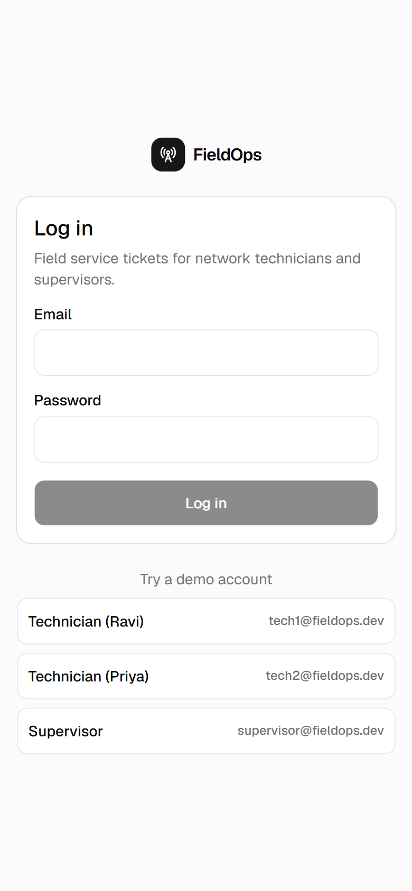
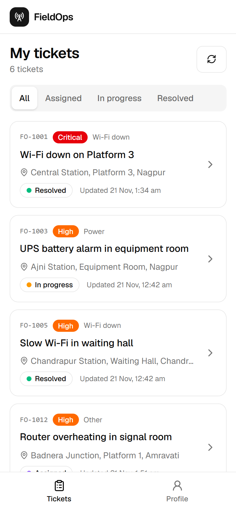
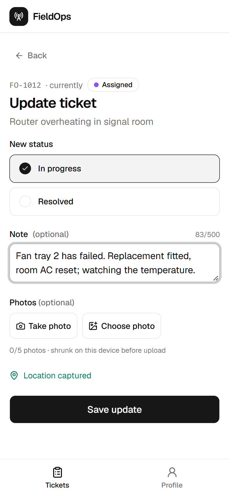
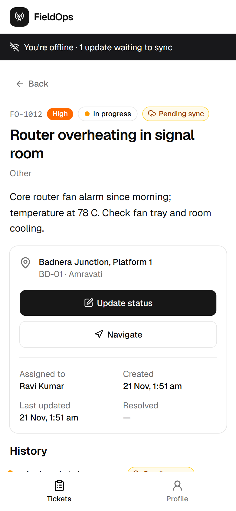
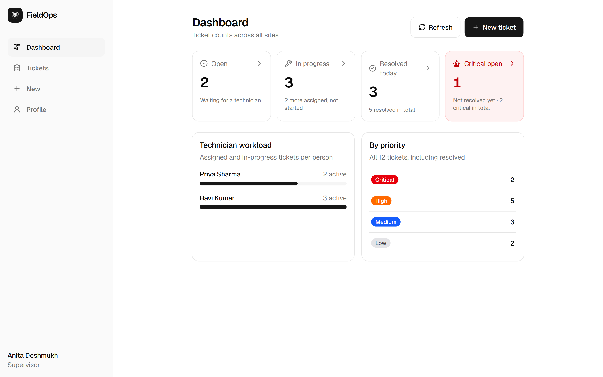
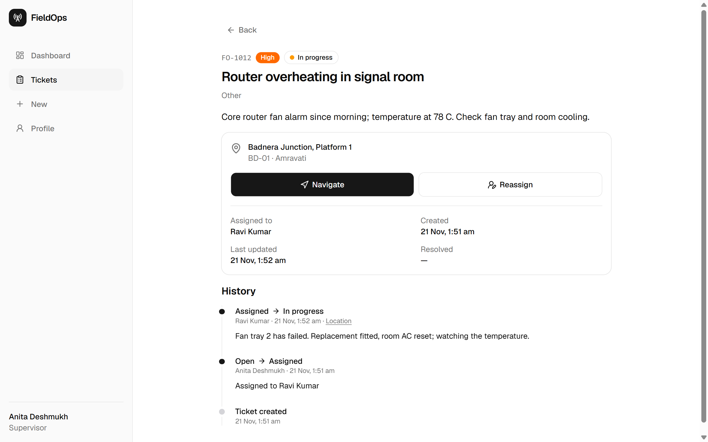

# FieldOps

**Offline-first field service web app for network technicians.** React, TypeScript, Spring Boot, PostgreSQL.

**Live:** https://field-ops-ak.vercel.app · **Demo video:** _coming soon_

| Role | Email | Password |
| --- | --- | --- |
| Technician | `tech1@fieldops.dev` | `Password@123` |
| Technician | `tech2@fieldops.dev` | `Password@123` |
| Supervisor | `supervisor@fieldops.dev` | `Password@123` |

The login page also has one-tap buttons for these accounts.

> The backend runs on a free server that sleeps after 15 minutes without traffic. The first page load after that can take up to a minute while it wakes up.

<p>
  
  
  
  
</p>
<p>
  
  
</p>

## What it does

A telecom team looks after Wi-Fi, fibre and network equipment at railway stations. When something breaks, a supervisor creates a ticket and assigns a technician. The technician updates it from their phone at the site, often with a weak signal or none at all.

- **Two roles:** technicians see and update only their own tickets; supervisors see everything, create tickets and reassign them.
- **Updates from the field:** a note, photos from the phone camera (resized in the browser before upload) and the GPS location, moving a ticket from Assigned to In progress to Resolved.
- **Works offline:** updates saved without a connection, photos included, wait on the phone and send themselves when the connection returns. The app also opens offline and shows the last-loaded tickets.
- **Installable:** add it to the home screen and it opens full-screen like an app (a PWA). No app store needed.
- **Supervisor dashboard:** counts by status and priority, critical tickets still open, and each technician's workload.
- **Navigate:** one tap opens Google Maps directions to the site.
- **Secure by default:** login token in an httpOnly cookie, ownership checks on the server, and photos in a private bucket served only to people allowed to see the ticket.

## Architecture

```
                 ┌───────────────────────────────────────────┐
  Phone/laptop   │ React PWA (Vite build)                    │
  browser        │  pages · TanStack Query · offline queue   │
                 │  (IndexedDB) · service worker (app shell) │
                 └──────────────────┬────────────────────────┘
                                    │ same origin: /api/... + httpOnly cookie
                 ┌──────────────────▼────────────────────────┐
  Vercel         │ static files + rewrite /api/* → Render    │   (locally: Vite dev proxy)
                 └──────────────────┬────────────────────────┘
                                    │
                 ┌──────────────────▼────────────────────────┐
  Render         │ Spring Boot API (one app, Docker)         │
                 │  JWT filter → controller → service →      │
                 │  repository                               │
                 └────────┬────────────────────────┬─────────┘
                          │ JDBC                   │ HTTPS
                 ┌────────▼─────────┐     ┌────────▼─────────┐
  Supabase       │ PostgreSQL       │     │ Storage bucket   │   (locally: Postgres +
                 │ (5 tables)       │     │ "attachments"    │    uploads/ folder)
                 └──────────────────┘     └──────────────────┘
```

Vercel forwards `/api` to the backend, so the browser sees the site and the API as one origin. The login cookie stays first-party, and `` sends it automatically.

## Tech stack

| Layer | Technology |
| --- | --- |
| Frontend | React 19, TypeScript, Vite, React Router |
| UI | Tailwind CSS, shadcn/ui, lucide-react |
| Server data | TanStack Query, with the cache saved to IndexedDB for offline start |
| Offline and PWA | IndexedDB (`idb-keyval`), `vite-plugin-pwa` (Workbox) |
| Backend | Spring Boot 4, Java 21, Spring Security, JJWT, BCrypt |
| Data | Spring Data JPA, PostgreSQL 17 |
| Photos | Supabase Storage (production), local folder (development) |
| Hosting | Vercel (website), Render (API, Docker), Supabase (database and storage) |
| Testing | Vitest, Playwright, Postman |

## How offline sync works

When the technician saves an update and the server can't be reached, the update and its photos (as Blobs) go into a queue in IndexedDB, the browser's built-in database ([`queue.ts`](web/src/offline/queue.ts)). The queue is sent oldest first, one item at a time, whenever the app opens, the connection comes back, the tab becomes visible again, or the user taps Sync now ([`useSync.ts`](web/src/offline/useSync.ts)). Each update carries a `clientUpdateId` made on the phone, so if a reply is lost and the update is sent twice, the server stores it only once. Network errors and a sleeping server are retried later; an expired login waits for the user to log in again; a rejection (for example, the ticket was reassigned meanwhile) moves the update to a failed list on the Profile page, where it can be retried or discarded.

## Run it locally

You need Java 21, Node.js 22+, pnpm and Docker.

1. **Database:** PostgreSQL 17 in Docker.
   ```bash
   docker run --name fieldops-postgres -e POSTGRES_PASSWORD=postgres -e POSTGRES_DB=fieldops -p 5432:5432 -d postgres:17
   ```
   After the first time, start it with `docker start fieldops-postgres`.
2. **Backend:** creates the tables and the demo data on first start, then listens on port 8080.
   ```bash
   cd backend
   ./mvnw spring-boot:run        # Windows: .\mvnw spring-boot:run
   ```
3. **Website:** the dev server forwards `/api` to port 8080.
   ```bash
   cd web
   pnpm install
   pnpm dev
   ```
4. Open http://localhost:5173 and log in with one of the demo accounts.

Offline mode needs the production build: run `pnpm build && pnpm preview` and open http://localhost:4173 ([details](web/README.md#trying-offline-mode)).

## Tests

| What | Tool | Run |
| --- | --- | --- |
| Offline queue, sync rules (sent, retry later, rejected, login expired), status rules | Vitest, with `fake-indexeddb` | `cd web && pnpm test` |
| End to end in a real browser: a technician sees only their own tickets; an update shows in the history; an update saved offline syncs after reconnecting | Playwright | `cd web && pnpm test:e2e` |
| Every API endpoint, including cookie login and photo upload | Postman | Import [`postman/FieldOps.postman_collection.json`](postman/FieldOps.postman_collection.json) |
| The backend starts with its full configuration | JUnit | `cd backend && ./mvnw test` |

`pnpm test:e2e` starts the backend and the production build by itself if they aren't running. The database container must be running.

## What I'd add next

- Backend unit tests (JUnit and Mockito) for the status rules, ownership checks and duplicate updates
- Refresh tokens, so a long shift doesn't end in a forced logout
- Flyway migrations instead of letting Hibernate update the schema
- Web push notifications when a ticket is assigned
- A CI pipeline that runs every test on each pull request
- Monitoring and error tracking for the live backend
